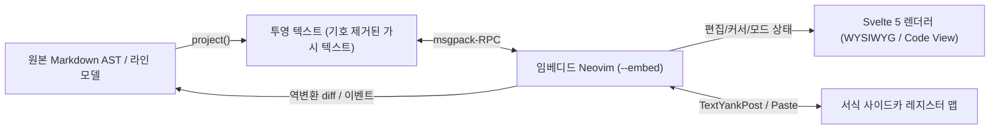

# mdvim 요구사항 및 기술 스펙 정의서 (v0.1)

> 본 문서는 37개 문답을 통해 수집된 요구사항([ideas.md](file:///home/gim/projects/mdvim/docs/ideas.md))과 2개의 기술 검증 스파이크(`spikes/01-projection`, `spikes/02-tauri-ime`) 결과를 바탕으로 정리된 **mdvim**의 공식 요구사항 및 아키텍처 스펙입니다.

---

## 1. 제품 비전 및 핵심 가치

**mdvim**은 마크다운(`.md`), 텍스트(`.txt`), 추후 HTML(`.html`) 파일을 보고 편집하는 크로스플랫폼 데스크톱 에디터입니다.

1. **원천적인 Vim 경험 (True Neovim Embedding)**
   - 단순한 키바인딩 에뮬레이션이 아니라 실제 **Neovim(`nvim --embed`)**을 임베딩하여 모든 Vim 모션, 텍스트 객체, 매크로, 레지스터, Ex 명령, 그리고 사용자의 기존 `init.lua` / `.vimrc` 및 플러그인을 그대로 지원합니다.
2. **단일 패인 코드 뷰 ↔ 완전 WYSIWYG 렌더링 뷰 토글**
   - 한 화면(단일 패인)에서 **코드 뷰(원본 마크다운)**와 **렌더링 뷰(완전 WYSIWYG)**를 즉시 전환할 수 있습니다.
   - 렌더링 뷰에서는 마크다운 문법 기호(`**`, `# `, `- ` 등)가 화면에 절대 노출되지 않으며, **렌더링된 화면 텍스트 위에서도 Vim의 모든 편집 동작이 보이는 그대로 동작**합니다.

---

## 2. 플랫폼 및 기술 스택

| 영역 | 선택 사양 | 비고 |
|---|---|---|
| **데스크톱 프레임워크** | **Tauri v2** (Rust) | Linux, macOS, Windows 3대 OS 모두 지원 필수 |
| **프론트엔드** | **Svelte 5 + TypeScript** | 경량 반응성, 정교한 DOM/커서/Preedit 제어 |
| **Vim 엔진** | **Neovim (`nvim --embed`)** | 시스템에 설치된 `nvim` 우선 사용, 없으면 앱 동봉(bundled) 바이너리 폴백 |
| **Neovim 설정 로드** | 사용자 `init.lua` / `.vimrc` 및 플러그인 기본 로드 | UI/좌표 충돌 방지를 위한 안전 래퍼 포함 |
| **앱 설정 저장** | **TOML 설정 파일** (`config.toml`) 우선 지원 | OS 표준 경로(`~/.config/mdvim/config.toml` 등), 추후 설정 UI 추가 |
| **다국어 (i18n)** | **한국어(`ko`) / 영어(`en`)** 초기부터 구조화 | 메시지 카탈로그 분리 |
| **CI/CD 및 배포** | **GitHub Actions** | Linux / macOS / Windows 3대 OS 자동 빌드 및 릴리스 파이프라인 |
| **라이선스** | 오픈소스 공개 | 동봉/포함 의존성(Neovim Apache-2.0 등) 라이선스 준수 |

---

## 3. 뷰 모드 및 마크다운 지원 범위

### 3.1 파일 형식별 뷰 동작
- **`.md` (Markdown)**: 코드 뷰 ↔ 렌더링 뷰(WYSIWYG) 토글 가능.
- **`.txt` (Plain Text)**: 코드 뷰 전용.
- **`.html` (HTML)**: MVP 이후 단계에서 렌더링 편집 범위 결정 (우선 코드 뷰 중심).

### 3.2 마크다운 문법 지원 단계
- **Phase 1 (MVP)**: **CommonMark + GFM (GitHub Flavored Markdown)**
  - 제목(`#`~`######`), 굵게(`**`), 기울임(`*`), 취소선(`~~`), 인라인 코드(`` ` ``)
  - 순서 없는 목록(`-`, `*`, `+`), 순서 있는 목록(`1.`), 체크박스 작업 목록(`- [ ]`, `- [x]`)
  - 인용문(`>`), 코드 블록(` ``` ` + 문법 하이라이트), 표(GFM Table), 수평선(`---`), 링크(`[text](url)`), 이미지(``)
- **Phase 2 (확장)**:
  - 수식(LaTeX/KaTeX), Mermaid 다이어그램, 위키링크(`[[ ]]`), 콜아웃(Callouts), 각주, YAML 프런트매터.

---

## 4. 핵심 아키텍처: WYSIWYG 투영 버퍼 & 역변환 엔진

Spike 1(`spikes/01-projection`)과 Spike 2(`spikes/02-tauri-ime`)에서 검증된 핵심 메커니즘입니다.



### 4.1 투영(Projection) 및 무손실 역변환 원칙
1. **무변경 바이트 보존 (Byte-Identical No-op Roundtrip)**
   - 사용자가 수정하지 않은 줄과 블록은 재직렬화하지 않고 원본 문자열(`raw`)을 그대로 유지하여 공백, 들여쓰기, 줄바꿈(LF/CRLF), 비정형 마크다운을 100% 보존합니다.
2. **서식 경계 입력 규칙**
   - 문자를 교체(replace, `cw` 등)할 때는 교체 대상 첫 글자의 인라인 서식을 상속합니다.
   - 순수 삽입(insert, `i`/`a`)할 때는 왼쪽 인접 글자의 인라인 서식을 상속합니다(굵은 글씨 끝에서 타이핑하면 굵게 연장, 시작 앞에서 타이핑하면 일반 텍스트).
   - 서식 구간 양끝에 입력된 공백은 마크다운 문법이 깨지지 않도록 마커(`**`) 바깥으로 자동 정규화합니다.
3. **서식 보존 복사/잘라내기 및 붙여넣기 (Rich Yank & Paste)**
   - 렌더링 뷰에서 `yy`, `dd`, `yw`, `dw` 등으로 복사/삭제 후 `p`/`P`로 붙여넣을 때 제목/목록 접두어와 인라인 서식(`**굵게**` 등)이 함께 복제되어야 합니다.
   - 이를 위해 Neovim의 `TextYankPost` 이벤트 발생 시 해당 레지스터(`v:event.regname`)에 대응하는 마크다운 서식 조각(Rich Span)을 사이드카 맵에 기록하고, 붙여넣기 시 서식을 복원합니다.
4. **통합 Undo / Redo 히스토리 (`u` / `Ctrl+R`)**
   - 코드 뷰와 렌더링 뷰를 전환해도 Undo/Redo 히스토리가 초기화되지 않고 하나로 이어져야 합니다.
   - 뷰 전환 시 버퍼를 파괴적으로 덮어쓰지 않고 문서 트랜잭션/Undo 상태를 동기화합니다.

### 4.2 렌더링 뷰 구조적 요소 및 서식 편집 규칙
- **서식 입력 방법 및 줄 이탈 시 즉시 렌더링**:
  - 단축키(예: Insert 모드 `Ctrl+B` 굵게, `Ctrl+I` 기울임 등) 지원.
  - **줄 이탈/확정 시 즉시 렌더링**: 렌더링 뷰에서 `# 안녕하세요`, `- 목록`, `**굵은 글씨**` 등 마크다운 문법 기호를 직접 타이핑한 뒤 `Enter`를 쳐서 다음 줄로 넘어가거나 다른 줄로 이동할 때(또는 `Esc`로 Insert 모드를 마칠 때), 코드 뷰로 갔다 올 필요 없이 **즉시 마크다운 기호가 파싱·숨김 처리되고 해당 줄이 렌더링**됩니다.
- **목록 및 인용 줄바꿈**:
  - 목록(`-`, `1.`, `- [ ]`)이나 인용(`>`) 줄에서 `Enter` 또는 `o`를 누르면 다음 항목 접두어가 자동으로 이어집니다.
  - 내용이 비어 있는 목록/인용 항목에서 한 번 더 `Enter`(또는 `Backspace`)를 누르면 목록/인용이 해제되고 일반 줄로 전환됩니다.
- **표 (Table)**:
  - 렌더링 뷰에서 셀 단위로 직접 편집하며, 셀 이동과 행/열 추가·삭제를 지원합니다.
- **코드 블록 (Code Block)**:
  - 렌더링 뷰 안에서 블록 내부를 코드처럼 직접 편집하며 문법 하이라이트를 표시합니다.
- **체크박스 (Task List)**:
  - 마우스 클릭 또는 단축키로 완료 여부를 즉시 토글합니다.
- **링크 (Link)**:
  - 클릭(또는 `Ctrl+클릭`)으로 열기, 키보드 단축키로 팝업을 띄워 텍스트/URL을 편집합니다.
- **이미지 (Image, MVP 포함)**:
  - 로컬/원격 이미지를 렌더링 뷰에 인라인 표시하고, 단축키 팝업으로 경로/대체 텍스트를 편집합니다.
  - **클립보드 이미지 붙여넣기**: 클립보드의 이미지를 붙여넣으면 현재 마크다운 파일과 같은 폴더(또는 `./assets/` 하위 폴더, 설정 가능)에 파일로 저장한 뒤 상대 경로 마크다운 링크를 자동 삽입합니다.

---

## 5. Neovim RPC 및 한글 IME 처리 명세 (Spike 2 검증 반영)

### 5.1 Neovim RPC 데드락 및 UI 프리징 방지 (필수 구현 수칙)
1. **비동기 백엔드 커맨드**:
   - 모든 Tauri RPC 커맨드는 `async fn` 또는 전용 I/O 워커 스레드로 분리하여 GTK/macOS/Windows 메인 UI 이벤트 루프가 절대 블로킹되지 않게 합니다.
2. **`nvim_get_mode()` 선행 확인**:
   - Vim이 후속 키 입력을 대기하는 상태(`r`, `f`, `t`, `q`, `@`, 레지스터 선택, Hit-Enter 프롬프트 등)에서는 `nvim_get_mode()`가 `blocking: true`를 반환합니다.
   - `blocking: true` 상태에서 `nvim_buf_get_lines`나 `nvim_win_get_cursor`를 호출하면 Neovim이 응답을 보류하여 RPC 데드락이 발생하므로, **반드시 논블로킹 API인 `nvim_get_mode()`를 먼저 호출**하고 `blocking: true`일 때는 버퍼/커서 조회를 건너뜁니다.

### 5.2 한글 IME 조합 입력 처리 (필수 구현 수칙)
1. **Insert 모드 한글 조합 (Preedit & Commit)**:
   - 조합 중(`compositionstart` ~ `compositionupdate`)에는 글자를 Neovim으로 보내지 않고 에디터 커서 위치에 인라인 Preedit 오버레이로 렌더링합니다.
   - **중복 입력 방지 (WebKitGTK + IBus 대응)**:
     - 조합 중이거나 `compositionend` 직후에 숨겨진 `<textarea>`의 `.value`를 강제로 수정하지 않습니다(IBus 컨텍스트 리셋으로 인한 이중 커밋 방지).
     - `keydown` 핸들러에서는 비-ASCII 완성형 문자(`charCodeAt(0) > 127`) 및 IME 조합 키(`isComposing`, `keyCode === 229`)를 Neovim으로 전달하지 않으며, 완성된 한글은 오직 `compositionend`의 `e.data`를 통해서만 직렬 큐로 전송합니다.
2. **조합 도중 `Esc` 키 입력**:
   - 한글 조합 도중 `Esc`를 누르면 현재 조합 중인 글자(preedit)를 먼저 Neovim 버퍼에 확정한 뒤 `<Esc>`를 보내 Normal 모드로 전환합니다.
3. **Normal 모드 한/영 상태**:
   - 표준 Vim 동작과 동일하게 Normal 모드에서 IME가 한글 상태이면 영문 모션(`hjkl` 등)으로 강제 변환하지 않습니다.

### 5.3 단축키 라우팅 규칙
- 어떤 단축키를 Neovim으로 보낼지, 앱 자체 기능(서식 토글 등)으로 처리할지 **설정 파일(`config.toml`)에서 사용자가 커스터마이징 가능**해야 합니다.
- **기본값**:
  - **Normal 모드**: `Ctrl+B`(페이지 위), `Ctrl+F`(페이지 아래), `Ctrl+R`(Redo), `Ctrl+V`(Visual Block) 등 모든 키를 Neovim에 우선 전달합니다.
  - **Insert 모드**: `Ctrl+B`(굵게), `Ctrl+I`(기울임), `Ctrl+K`(링크 편집) 등을 편집용 서식 단축키로 동작시킵니다.

---

## 6. 파일 관리, 저장 및 UI 구성 (MVP 범위)

### 6.1 UI 레이아웃
- **상단 바**: 열려 있는 여러 파일을 전환하는 **탭 바(Tab Bar)** + 뷰 모드 토글 스위치(렌더링 뷰 / 코드 뷰).
- **중앙 패인**: 단일 패인 에디터 영역 (분할 화면 없음).
- **하단 바**:
  - **상태바(Statusline)**: 현재 Vim 모드(`NORMAL`, `INSERT`, `VISUAL`, 키 입력 대기 등), 커서 위치(행/열), 파일명 및 저장 상태, 뷰 모드 표시.
  - **Vim 명령줄**: `:`(Ex 명령) 및 `/`, `?`(검색) 입력 시 하단 바에 표시.
- **테마**: 기본(Default) 테마는 **Light(라이트) 테마**로 제공하며, MVP에서는 완성도 높은 라이트 기본 테마를 적용하고 추후 다크/라이트 전환 및 커스텀 CSS/폰트 설정으로 확장합니다.

### 6.2 파일 열기, 저장 및 외부 변경 감지
- **단일 파일 중심 + 멀티 탭**: 폴더 트리(Vault) 없이 개별 파일을 여러 탭으로 열어 편집합니다(폴더 트리 지원은 추후 단계).
- **최근 파일 목록 (Recent Files)**: 최근에 열었던 파일 목록을 기록하고 빠르게 다시 열 수 있습니다.
- **자동 저장 (Auto-save) + `:w` / `:q` 호환**:
  - 일정 시간 간격, 타이핑이 멈췄을 때(debounce), 창이 포커스를 잃었을 때(blur) 모두 자동 저장이 동작합니다.
  - Vim의 `:w`, `:q`, `:wq`, `:qa` 명령도 그대로 동작합니다.
  - **탭과 `:q` 규칙**: 열린 탭이 여러 개일 때 `:q`는 현재 탭만 닫고, 마지막 남은 탭에서 `:q`를 실행하거나 `:qa`를 실행하면 앱을 종료합니다.
- **외부 파일 변경 감지 (File Watcher)**:
  - 외부 프로그램이 파일을 변경했을 때 현재 버퍼가 수정 중(dirty)이 아니면 자동으로 다시 불러오고, 수정 중이면 충돌 알림을 띄워 사용자가 선택하게 합니다.
